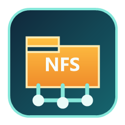
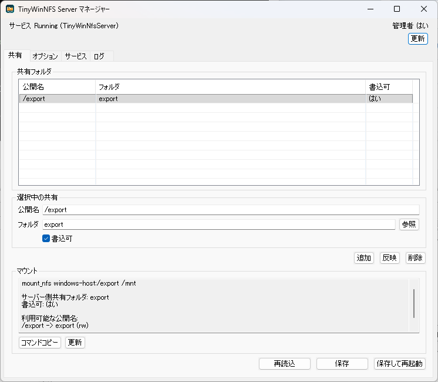

#  TinyWinNFS Server

**Windows のフォルダを、NFS で共有。**

TinyWinNFS Server は、Windows のフォルダを NFS クライアントから読み書きできるようにするサーバーです。共有したいフォルダを管理ツールで選び、Windows サービスとして常駐させられます。

QNX 4.25 とのファイルのやり取りを大切にしながら、Windows Client for NFS でも動作を確認しています。QNX 専用ではなく、NFSv2 / NFSv3 と UDP / TCP に対応しています。

Java 21 で実装し、v2.0.0 から正式版として提供しています。インストーラーには Java runtime と管理ツールを同梱しているので、使い始めるために Java を別途インストールする必要はありません。

📥 [最新版をダウンロード](https://github.com/EnterOgawa/tinywin-nfs-server/releases/latest) · 📖 [導入・更新ガイド](docs/install_upgrade_uninstall.md) · 💬 [不具合・ご提案](https://github.com/EnterOgawa/tinywin-nfs-server/issues)

## 📥 入手とインストール

まずは [GitHub Releases](https://github.com/EnterOgawa/tinywin-nfs-server/releases/latest) から `TinyWinNfsSetup.exe` をダウンロードし、インストーラーを実行してください。

| 項目 | 内容 |
|---|---|
| 対象OS | Windows Pro / Windows Server 系。対象版・検証状況は [サポート範囲](docs/support_scope.md) を参照 |
| CPU / ファイルシステム | 主な対象は Windows x64 / NTFS。32bit・ARM64・その他の構成は同等の検証範囲には含めていません |
| 配布形式 | 署名済み Inno Setup インストーラー |
| Java | 同梱 runtime を使用するため、別途インストールは不要です |
| 権限 | インストール、サービス操作、ファイアウォール変更には管理者権限が必要 |
| サービス | `TinyWinNfsServer` として登録 |
| 既定ポート | Portmap `111`、NFS `2049`、MOUNT `20048` |

インストールが終わったら、スタートメニューまたはデスクトップのショートカットから `TinyWinNFS Server Manager` を開きます。

## 🚀 まずはフォルダを共有してみましょう

最初に設定するのは、共有したいフォルダと、クライアントから見える公開名です。複数のフォルダも登録できます。

1. 管理ツールの `共有` タブで、公開名（例: `/export`）と Windows 側のフォルダを設定します。
2. 書き込みを許可するか、どのクライアントに共有するかを選びます。
3. `保存して再起動` を押して、設定をサービスへ反映します。
4. クライアント側から公開名をマウントします。コマンドは管理ツールで確認・コピーできます。
5. うまくつながらないときは、`診断` タブと `ログ` タブを確認してみてください。

> [!IMPORTANT]
> 信頼できる LAN 内での利用を想定しています。許可クライアントが空欄の場合は全クライアントを許可するため、実運用では必要な IP アドレスを登録し、ファイアウォールの公開範囲も絞ってください。[セキュリティとアクセス制限](docs/security_model.md)

## 🖥️ 管理ツールの画面

共有フォルダ、書き込みの許可、許可クライアントをひとつの画面で設定できます。表示は日本語と英語に対応しています。



## ✨ できること

現在の対応範囲をまとめました。詳しい条件や未対応の機能は、後半の「使う前に知っておきたいこと」でも確認できます。

| 項目 | v2.1.0 の状態 |
|---|---|
| NFS | NFSv2 / NFSv3 |
| MOUNT | MOUNT v1-v3 |
| 認証 | AUTH_SYS |
| 通信方式 | UDP / TCP |
| 共有 | 複数 export、読み書き |
| ファイル操作 | 通常ファイル、ディレクトリ、rename、remove、mkdir、rmdir、link |
| NFS 属性 | mode / UID / GID の変更・保持。Windows ACL や Windows 所有者への完全変換ではありません |
| symlink | `READLINK` / `SYMLINK` 対応。ただし Windows の symlink 作成権限とファイルシステム機能に依存 |
| NFSv3互換情報 | `FSINFO` / `FSSTAT` / `PATHCONF` の主要値を設定・Windows容量情報から応答 |
| 運用診断 | export状態、設定警告、大文字小文字衝突、環境・サービス情報を診断パッケージに出力 |
| 管理ツール | 診断ビュー、サーバーログ検索、設定インポート/エクスポート、クライアント別mount支援 |
| 性能/負荷検証 | ローカルRPCベンチマーク、長時間負荷ループ、大量READDIR回帰テスト |
| 検証対象 | QNX 4.25: NFSv2/UDP、Windows Client for NFS: NFSv3/UDP と NFSv3/TCP、Linux/WSL: 任意回帰 |
| 互換性回帰 | NFSエラー応答、属性応答、複数クライアント相当の相互編集、Windows NFS検証マトリクス、export境界検証 |
| 正式版文書 | サポート範囲、設定互換性、セキュリティ、インストール/更新/アンインストール |
| 対応外 | NFSv3 `MKNOD` などの特殊デバイスノード作成、NLM/file locking、NFSv4 |

## 📁 ファイルの保存場所

設定やログを探すときは、次の表をご覧ください。v1.7.1 以降は、アプリ本体と設定・ログなどの可変データを別々に保存しています。

| 種別 | パス |
|---|---|
| アプリ本体 | `C:\Program Files\EnterOgawa\TinyWinNFS Server` |
| 設定ファイル | `C:\ProgramData\EnterOgawa\TinyWinNFS Server\conf\nfs-server.properties` |
| 既定 export | `C:\ProgramData\EnterOgawa\TinyWinNFS Server\export` |
| TinyWinNFS ログ | `C:\ProgramData\EnterOgawa\TinyWinNFS Server\logs\nfs-server.log` |
| 設定バックアップ | `C:\ProgramData\EnterOgawa\TinyWinNFS Server\conf\backups` |
| 診断パッケージ | `C:\ProgramData\EnterOgawa\TinyWinNFS Server\diagnostics` |
| WinSW サービスログ | `C:\Program Files\EnterOgawa\TinyWinNFS Server\service\winsw` |
| 同梱デフォルト設定 | `C:\Program Files\EnterOgawa\TinyWinNFS Server\defaults\conf` |

旧バージョンの `C:\Program Files\EnterOgawa\TinyWinNFS Server\conf\nfs-server.properties` が存在し、かつ `ProgramData` 側の設定がまだない場合は、初回インストール/起動時に `ProgramData` 側へ移行します。
設定保存時と旧設定移行時には、既存設定を `conf\backups` 配下へ最大 10 世代保存します。

## 🛠️ 開発に参加するには

ソースを読んでみたい方、改善に参加したい方はこちらからどうぞ。開発環境・コーディング規約・PR の手順は [CONTRIBUTING.md](CONTRIBUTING.md) にまとめています。

Java 21 JDK を `JAVA_HOME` または `TINYWIN_NFS_JDK` で指定し、固定版の SWT を取得します。取得ファイルは SHA-256 で検証します。

```powershell
$env:JAVA_HOME = 'C:\path\to\jdk-21'
.\scripts\prepare-dependencies.ps1
```

JDK の場所は各ビルドスクリプトの `-JdkPath` でも指定できます。Eclipse のインストール先に依存しません。

### Eclipse

Eclipse では、このフォルダを `Existing Projects into Workspace` で取り込めます。

Eclipse では JavaSE-21 の実行環境を設定してください。
SWT は上記コマンドで用意した `lib/org.eclipse.swt.win32.win32.x86_64.jar` を参照します。

### コンパイル

```powershell
.\scripts\compile.ps1
```

### 単体テスト

```powershell
.\scripts\test.ps1
```

既定はサーバーを起動しない19件の確認です。通信テストは明示的に `-Suite Transport`、両方は `-Suite All` を指定します。通信テストは高番ポートで NFS サーバーを起動します。
GitHub Actions は Windows / Java 21 上で依存取得と `Unit` の確認のみを実行します。

### ローカルRPCベンチマーク

ネットワークポートやWindowsサービスを使わず、NFSv2手続きをプロセス内で呼び出して、作成、書込、LOOKUP、READDIR、rename、削除を測定します。

```powershell
.\scripts\benchmark-local-rpc.ps1 -Files 1000 -Directories 10 -Depth 1
```

結果は `work\analysis\v1.12.0-benchmark` に Markdown と CSV で保存します。

### Windows Client for NFS 検証

Windows 標準 NFS クライアントで UDP/TCP をまとめて確認します。

```powershell
.\scripts\test-windows-nfs-client-matrix.ps1
```

結果は `work\analysis\windows-nfs-client-matrix` に Markdown で保存します。Windows の `mount.exe` は portable な NFS version option を公開していないため、サーバーログで MOUNT v3 / NFSv3 RPC を確認します。

### 管理ツール作成

```powershell
.\scripts\package-manager.ps1
```

生成先:

```text
dist\TinyWinNfsManager
```

### インストーラー作成

```powershell
.\scripts\package-installer.ps1
```

生成先:

```text
dist\installer\TinyWinNfsSetup.exe
```

同時に対応ソース `dist\installer\TinyWinNfsSources.zip` を生成します。配布用 runtime はコンポーネント一覧に指定した Temurin 21.0.11+10 に固定し、対応ソースとの版を照合します。
次の配布からサービスラッパーには WinSW NET461 版を使い、OS 側の .NET Framework 4.8 以降を前提にします。インストーラーはその前提を確認します。
公開時はユーザーがインストーラーに署名し、exe とソース ZIP を同じリリースへ添付します。CI は署名・公開を行いません。[メンテナー向け手順](docs/maintainer_guide.md)

## 🔄 Windows サービスとして使う

管理ツールを閉じても、サービスが起動していれば共有を続けられます。サービス化の詳しい手順は [Windows サービスのガイド](docs/windows_service.md) をご覧ください。

インストーラーでサービスをインストールした場合、`TinyWinNfsServer` として登録されます。

| 項目 | 値 |
|---|---|
| サービス ID | `TinyWinNfsServer` |
| 旧サービス ID | `OgawaNfsServer`, `QnxNfsServer` |
| Portmap | UDP/TCP `111` |
| NFS | UDP/TCP `2049` |
| MOUNT | UDP/TCP `20048` |

UDP/TCP `111` と `2049` を利用するため、Windows ファイアウォールの公開範囲と他のサービスとのポート競合を確認してください。サービス操作とファイアウォール変更には管理者権限が必要です。

## 🌐 管理ツールと言語設定

管理ツールは SWT で実装した Windows 向けアプリです。SWT は Eclipse 2025-03 付属の `org.eclipse.swt.win32.win32.x86_64` jar を同梱します。

インストール後のスタートメニュー/デスクトップショートカットは `TinyWinNfsManager.exe` を直接起動します。インストーラーは Windows の `RUNASADMIN` 互換設定を登録するため、UAC 経由で管理者起動されます。

表示言語は通常、自動判定に任せられます。日本語または英語に固定したい場合は、`ui.language` を設定してください。

| 設定 | 値 |
|---|---|
| 自動判定 | `ui.language=auto` |
| 英語 | `ui.language=en` |
| 日本語 | `ui.language=ja` |

## ⚙️ 設定を詳しく見る

通常の設定は管理ツールから行えます。ポートや性能などを細かく調整したい場合は、以下の設定も利用できます。

ファイルを直接編集する場合は、次のファイルを変更してサービスを再起動してください。

```text
C:\ProgramData\EnterOgawa\TinyWinNFS Server\conf\nfs-server.properties
```

### 共有設定

複数 export は `exports.count` と `exports.N.*` で定義します。`export.*` は先頭共有との互換用です。

| キー | 既定値 | 説明 |
|---|---|---|
| `exports.count` | `1` | 共有定義数 |
| `exports.N.name` | `/export` | NFS クライアントから見える export 名。`/` で始める |
| `exports.N.path` | `export` | Windows 側共有フォルダ。相対パスはデータルート基準 |
| `exports.N.writable` | `true` | `true`: 書込可、`false`: 読込専用 |
| `exports.N.allowed.clients` | 空欄 | 許可する IPv4 アドレスのカンマ区切り。空欄なら全クライアント許可 |

読み書きできる共有と、読み込み専用の共有を登録する例です。

```properties
exports.count=2
exports.1.name=/export
exports.1.path=export
exports.1.writable=true
exports.1.allowed.clients=
exports.2.name=/readonly
exports.2.path=C:\\data\\readonly
exports.2.writable=false
exports.2.allowed.clients=192.168.1.30
```

### ネットワーク設定

| キー | 既定値 | 説明 |
|---|---|---|
| `portmap.port` | `111` | Portmap の UDP/TCP ポート |
| `nfs.port` | `2049` | NFS の UDP/TCP ポート |
| `mount.port` | `20048` | MOUNT の UDP/TCP ポート |
| `rpc.udp.workers` | `8` | UDP RPC 要求を処理するワーカー数 |
| `rpc.udp.queue.size` | `1024` | UDP RPC ワーカーへ渡す待ち行列サイズ |
| `rpc.tcp.timeout.millis` | `30000` | TCP RPC クライアント接続の読み取りタイムアウト |
| `client.server.host` | `windows-host` | 管理ツールが表示する mount コマンド用のホスト名 |
| `client.mount.point` | `/mnt` | 管理ツールが表示する mount コマンド用のクライアント側マウント先 |
| `client.mount.profile` | `0` | 管理ツールの mount 表示。`0`: QNX、`1`: Windows Client for NFS、`2`: Linux/WSL |
| `client.mount.protocol` | `0` | 管理ツールの protocol 表示。`0`: NFSv2 UDP、`1`: NFSv3 UDP、`2`: NFSv3 TCP |

### 権限/属性設定

| キー | 既定値 | 説明 |
|---|---|---|
| `permission.identity` | `auto` | `auto`: AUTH_SYS の UID/GID を属性応答に反映、`fixed`: `uid` / `gid` を固定返却 |
| `uid` | `0` | `permission.identity=fixed` 時の UID |
| `gid` | `0` | `permission.identity=fixed` 時の GID |
| `file.mode` | `0644` | 通常ファイルの既定 mode |
| `directory.mode` | `0755` | ディレクトリの既定 mode |
| `block.size` | `4096` | 属性/FS 情報で返すブロックサイズ |
| `read.size` | `8192` | NFS READ の最大応答サイズ |
| `write.size` | `8192` | NFSv3 `FSINFO` で返す write 最大/推奨サイズ |
| `directory.preferred.size` | `4096` | NFSv3 `FSINFO` で返すディレクトリ推奨読込サイズ |
| `max.file.size` | `9223372036854775807` | NFSv3 `FSINFO` で返す最大ファイルサイズ |
| `time.delta.nanos` | `1000000` | NFSv3 `FSINFO` で返す時刻精度ナノ秒 |
| `pathconf.link.max` | `1024` | NFSv3 `PATHCONF` で返す link 最大値 |
| `pathconf.name.max` | `255` | NFSv3 `PATHCONF` で返すファイル名最大バイト数 |
| `filename.charset` | `UTF-8` | NFSv2 ファイル名/リンクパス文字列の文字コード。Java の Charset 名を指定 |

### 性能設定

| キー | 既定値 | 説明 |
|---|---|---|
| `write.sync` | `false` | `false`: WRITE 応答前の物理同期を省略して性能優先、`true`: 各 WRITE を同期 |
| `write.cache.enabled` | `true` | 書込ファイルキャッシュの有効化 |
| `write.cache.max.open` | `64` | 書込キャッシュで保持する最大オープン数 |
| `write.cache.idle.millis` | `3000` | アイドル状態の書込ファイルを保持する時間 |

性能設定の調整時は、通常の単体テストに加えて [docs/performance_testing.md](docs/performance_testing.md) のローカルRPCベンチマークを実行してください。

NFS クライアントから `chmod` / `SETATTR mode`、`chown` / `chgrp` 相当の `SETATTR uid/gid` が実行された場合、TinyWinNFS Server は NFS mode/UID/GID をメタデータとして保持し、後続の属性応答へ反映します。これは Windows ACL や Windows ファイル所有者の完全変換ではありません。

## 🔌 クライアントから接続する

サーバー側の共有設定ができたら、クライアントからマウントします。`windows-host` はサーバーのホスト名または IP アドレスに、`/export` は設定した公開名に置き換えてください。

**QNX 4.25**

```text
mount_nfs windows-host:/export /mnt
```

**Windows Client for NFS（同じ Windows マシンから接続する例）**

```powershell
mount -o anon \\127.0.0.1\export Z:
```

別のマシンから接続する場合は、`127.0.0.1` をサーバーの IP アドレスまたはホスト名に置き換えます。事前のクライアント設定を含む詳しい手順は、次のガイドをご覧ください。

| 対象 | ドキュメント |
|---|---|
| QNX 4.25 | [QNX のマウント手順](docs/qnx425_mount.md) |
| Windows Client for NFS | [Windows の接続・検証手順](docs/windows_nfs_client_test.md) |
| WSL/Linux | [WSL/Linux のマウント手順](docs/wsl_mount_test.md) |
| サポート範囲 | [対象環境と検証状況](docs/support_scope.md) |
| 設定互換性 | [設定の互換性と移行](docs/configuration_compatibility.md) |
| セキュリティとアクセス制限 | [安全に共有するための設定](docs/security_model.md) |
| インストール/更新/アンインストール | [導入・更新・削除の手順](docs/install_upgrade_uninstall.md) |
| NFS手続きカバレッジ | [NFS 手続きの対応一覧](docs/nfs_procedure_coverage.md) |
| Windowsファイルシステム制約 | [Windows のファイル名・属性の制約](docs/windows_filesystem_constraints.md) |
| 性能/負荷確認 | [性能と負荷の確認方法](docs/performance_testing.md) |

## 🧪 動作を確かめる

目的に合った確認方法を選べます。まずはサーバーを起動しない単体テストから始められます。

| 目的 | コマンド |
|---|---|
| サーバーを起動しない単体テスト | `.\scripts\test.ps1 -Suite Unit` |
| 高番ポートの TCP 通信テスト | `.\scripts\test.ps1 -Suite Transport` |
| 単体・通信テストの両方 | `.\scripts\test.ps1 -Suite All` |
| サービス UDP スモークテスト | `.\scripts\smoke-service.ps1` |
| サービス TCP スモークテスト | `.\scripts\smoke-service.ps1 -Transport TCP` |
| ファイル整合性確認 | `.\scripts\smoke-service.ps1 -VerifyFileIntegrity` |
| 大量ツリー整合性確認 | `.\scripts\smoke-service.ps1 -VerifyLargeTreeIntegrity` |
| 再起動後ハンドル確認 | `.\scripts\smoke-service.ps1 -RestartHandlePersistence` |
| Windows Client for NFS 結合テスト | `.\scripts\test-windows-nfs-client.ps1` |
| Windows Client for NFS TCP 結合テスト | `.\scripts\test-windows-nfs-client.ps1 -Transport TCP` |
| Windows Client for NFS UDP/TCP マトリクス | `.\scripts\test-windows-nfs-client-matrix.ps1` |
| Windows Client for NFS protocol 事前設定済み確認 | `.\scripts\test-windows-nfs-client.ps1 -Transport TCP -SkipProtocolChange` |
| Windows Client for NFS レポート指定 | `.\scripts\test-windows-nfs-client.ps1 -ReportPath work\analysis\windows-nfs-client\manual.md` |
| 長時間稼働確認 | `.\scripts\test-service-stability.ps1 -DurationMinutes 60 -IntervalSeconds 15 -RestartEveryIterations 10` |
| v2.0.0 リリース確認 | [docs/release_checklist_v2_0_0.md](docs/release_checklist_v2_0_0.md) |

このリポジトリでは環境依存を避けるため、サーバー起動を伴う確認は手動確認対象です。

## ⚠️ 使う前に知っておきたいこと

Windows とクライアント側のファイルシステムには違いがあります。特に大文字小文字を区別する環境とのコピーや、同じファイルの同時編集では、次の点にご注意ください。

| 項目 | 説明 |
|---|---|
| 大文字小文字 | 通常のWindowsフォルダでは `File.h` と `file.h` は同一ファイル扱いです。QNXなど大文字小文字を区別する環境からコピーする場合は事前に衝突を確認してください |
| 予約文字 | Windowsで利用できない文字や予約名は、NFSクライアント側で作成できません |
| ファイル名長 | NFSv2/v3とWindowsの双方の上限に制限されます。`pathconf.name.max` はNFSv3応答値です |
| symlink | `READLINK` は Windows symlink のリンク先を返します。`SYMLINK` は Windows 側で symlink 作成が許可されている場合のみ実体として作成します |
| symlink 作成失敗 | 権限不足やファイルシステム非対応の場合は `ACCES` / `PERM` を返します。通常ファイルへのフォールバック作成は行いません |
| 壊れた symlink | `READLINK` でリンク先文字列を返しますが、リンク先の実体は保証しません |
| file locking | NLM/file locking は未実装です |
| NFSv4 | 未実装です |
| 特殊デバイス | NFSv3 `MKNOD` などの特殊デバイスノード作成は未対応です |

正式版の詳しいサポート範囲と既知の制限は [サポート範囲](docs/support_scope.md) にまとめています。

## 📄 ライセンス

TinyWinNFS Server は [Apache License 2.0](LICENSE) で公開しています。ライセンスの条件に従って、利用・改変・再配布できます。

配布物に同梱する第三者コンポーネントのライセンスは [THIRD_PARTY_NOTICES.md](THIRD_PARTY_NOTICES.md) を参照してください。

## 💬 不具合の報告・改善のご提案

「この環境でつながらない」「こんな設定があると便利」といった気づきは、[GitHub Issues](https://github.com/EnterOgawa/tinywin-nfs-server/issues) へお寄せください。報告用のテンプレートも用意しています。

不具合を報告するときは、利用バージョン、Windows / クライアントの種類、再現手順があると確認しやすくなります。ログや設定を添付する前に、個人情報や機密情報が含まれていないか確認をお願いします。

脆弱性の詳細は公開 Issue に書かず、[SECURITY.md](SECURITY.md) の手順でご連絡ください。

保守は最新の安定リリースを中心に、可能な範囲で対応しています。応答期限や SLA の保証はありません。
依存関係の版・更新方針は [依存関係の管理](docs/dependency_maintenance.md)、対応ソースの取得方法は [ソース配布](docs/source_distribution.md) で確認できます。
